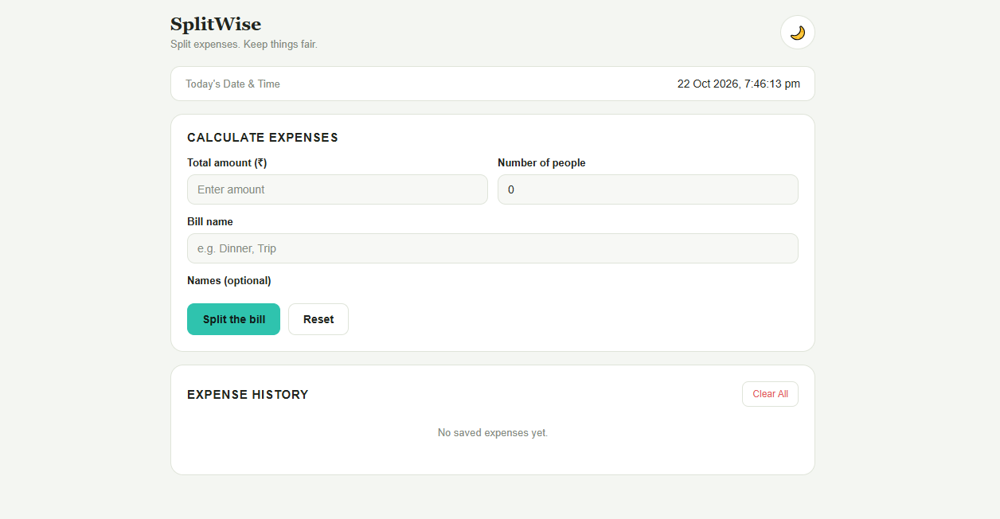
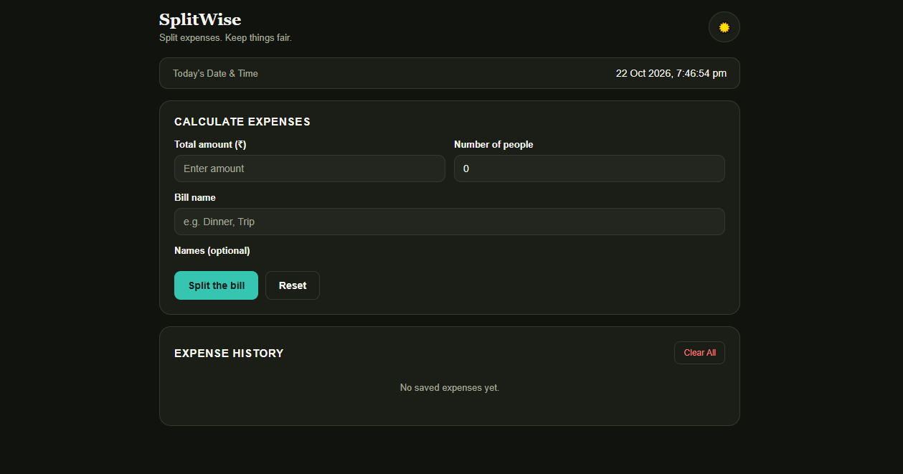
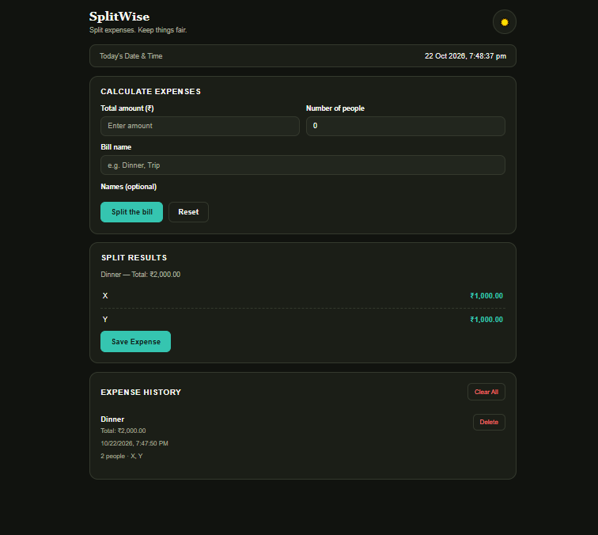
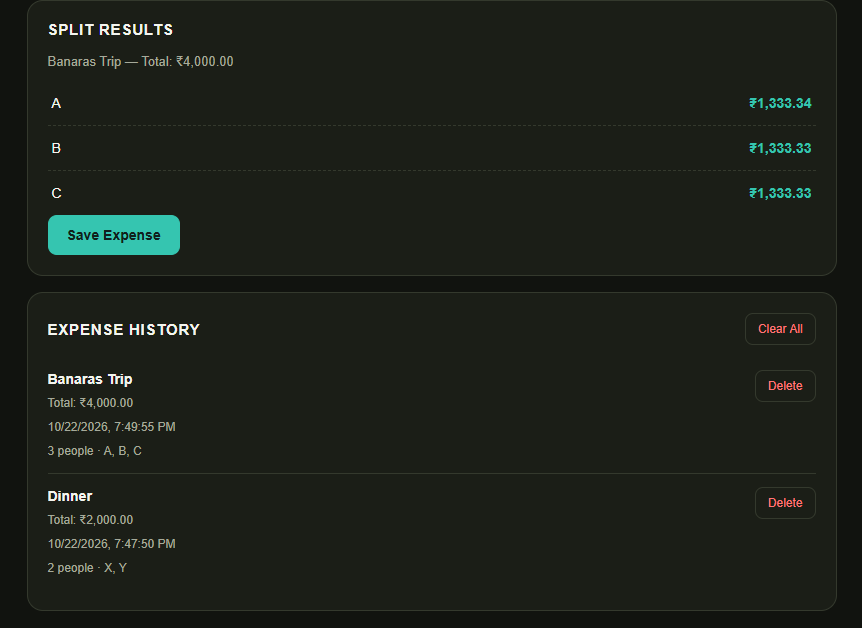

# SplitWise Calculator 💸

A simple, responsive expense-splitting calculator built using HTML, CSS, and JavaScript.

Split bills fairly among friends, calculate individual shares, and save your expense history directly in your browser.

## 📸 Screenshots

### Light Mode


### Dark Mode


### Split Results


### Expense History


## ✨ Features

- Calculate the amount each person needs to pay.
- Enter the total bill and number of people.
- Add individual names.
- Display the current date and time.
- Switch between light mode and dark mode.
- Save expenses using browser localStorage.
- View and delete saved expenses.
- Responsive design for desktop and mobile screens.

## 🛠️ Technologies Used

- HTML5
- CSS3
- JavaScript
- Browser localStorage

## 🚀 How to Run

1. Clone this repository:

   ```bash
   git clone https://github.com/divyanshisrivastva25/JS-SplitWise-Calculator.git
   ```

2. Open the project folder in VS Code.
3. Open `splitwise.html` in your browser, or run it using the Live Server extension.
4. Enter the bill amount, number of people, and their names.
5. Click **Split the bill** to calculate individual shares.

## 💾 Data Storage

Expenses and theme preferences are saved in the browser using `localStorage`.

Data remains available in the same browser unless its stored site data is cleared. Expenses are not synchronized across devices.

## 👩‍💻 Author

**Divyanshi Srivastava**

GitHub: [divyanshisrivastva25](https://github.com/divyanshisrivastva25)

---

If you find this project useful, consider giving the repository a ⭐.
